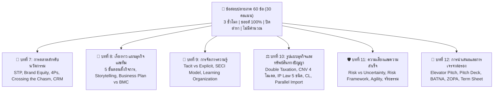

---
tags:
  - technopreneurs
  - exam
  - final-exam
  - study-guide
created: 2026-10-09
updated: 2026-10-10
type: exam-guide
---

# 🎯 Final Examination Blueprint & Study Guide (วิชาผู้ประกอบการนวัตกรรม)

> [!IMPORTANT] ข้อมูลสำคัญการสอบปลายภาค (Final Exam Briefing)
> - **รหัสวิชา:** 080203914 ผู้ประกอบการนวัตกรรม (Innovative Technopreneurs)
> - **วันสอบ:** **วันพุธที่ 28 ตุลาคม 2569**
> - **เวลาสอบ:** **09:00 – 12:00 น.** (ระยะเวลา 3 ชั่วโมงเต็ม มาให้ทัน 9 โมงตรง!)
> - **รูปแบบข้อสอบ:** **ปรนัย (Multiple Choice / ชอยส์) ทั้งหมด 60 ข้อ**
> - **คะแนนสอบ:** **30 คะแนน** (ข้อละ 0.5 คะแนน)
> - **ขอบเขตเนื้อหา:** **บทที่ 7 ถึง บทที่ 12** (ทั้งหมด 6 บท)
> - **ระเบียบการสอบ:**
>   - **ปิดตำรา (Closed-book):** ห้ามนำเอกสาร ตำรา หรือสรุปใดๆ เข้าห้องสอบ
>   - **ห้ามนำเครื่องคิดเลขเข้าห้องสอบ:** **ไม่มีข้อสอบคำนวณเด็ดขาด** เน้นทฤษฎี นิยาม คอนเซปต์ และการประยุกต์
>   - **ภาษาในข้อสอบ:** ข้อสอบเป็นภาษาไทยเป็นหลัก ศัพท์เทคนิคภาษาอังกฤษจะมีวงเล็บกำกับไว้
> - **การเช็กห้องสอบ:** ตรวจสอบห้องสอบและรายชื่อผู้มีสิทธิ์สอบในระบบให้เรียบร้อยก่อนวันสอบ

---

## 📊 โครงสร้างคะแนนและการตัดเกรด (Grading Policy)

| หมวดการให้คะแนน | คะแนนเต็ม | สถานะ | รายละเอียด |
| :--- | :---: | :---: | :--- |
| **คะแนนเก็บระหว่างภาค (Class Activities)** | 40% (40 คะแนน) | เก็บคะแนนแล้ว | การมีส่วนร่วม, เวิร์กช็อป, เล่มรายงาน Final |
| **สอบกลางภาค (Midterm Exam)** | 30% (30 คะแนน) | สอบไปแล้ว | เนื้อหาบทที่ 1 – 6 |
| **สอบปลายภาค (Final Exam)** | 30% (30 คะแนน) | **สอบ 28 ต.ค. 69** | **60 ข้อ ปรนัย (บทที่ 7 – 12)** |
| **รวมทั้งสิ้น** | **100% (100 คะแนน)**| | |

> [!TIP] กลยุทธ์พิชิตเกรด A (A $\ge$ 80 คะแนน)
> ข้อสอบ 60 ข้อ คิดเป็น 30 คะแนน (ถูก 2 ข้อ = 1 คะแนน) หากมีคะแนนเก็บและมิดเทอมสะสมอยู่ประมาณ 55-65 คะแนน การทำข้อสอบไฟนอลให้ได้เพียง 35-40 ข้อ (17.5-20 คะแนน) ก็สามารถการันตีเกรด A ได้ทันที!

---

## 🗺️ แผนผังและสาระสำคัญของข้อสอบ 6 บท (บทที่ 7 – 12)



---

### 📘 บทที่ 7: การตลาดสำหรับธุรกิจนวัตกรรมและเทคโนโลยี (Marketing for Innovation)
1. **กระบวนการตลาดนวัตกรรม:** การเปลี่ยนสิ่งประดิษฐ์และเทคโนโลยีให้กลายเป็นคุณค่าและรายได้ในเชิงพาณิชย์
2. **การกำหนดกลุ่มเป้าหมายและการวางตำแหน่ง (STP Marketing):**
   - **Segmentation:** การแบ่งส่วนตลาดตามพฤติกรรมและความต้องการ
   - **Targeting:** การเลือกกลุ่มลูกค้าเป้าหมายหลักที่เปิดรับนวัตกรรม
   - **Positioning:** การกำหนดจุดยืนผลิตภัณฑ์บนแผนที่การแข่งขัน (Perceptual Map)
3. **Brand Equity (สินทรัพย์แบรนด์):** คุณค่าของตราสินค้าในใจลูกค้า การสร้าง Brand Awareness และ Brand Loyalty
4. **ส่วนประสมทางการตลาดสำหรับนวัตกรรม (4Ps):**
   - **Product:** คุณสมบัติสินค้า/บริการที่ตอบโจทย์ Pain Points
   - **Price:** กลยุทธ์การตั้งราคา (เช่น Skimming Pricing สำหรับนวัตกรรมใหม่ หรือ Penetration Pricing เพื่อครองตลาด)
   - **Place:** ช่องทางการจัดจำหน่ายดิจิทัลและแพลตฟอร์ม
   - **Promotion:** การสื่อสารตลาดแบบบูรณาการ (IMC) และ Social Media
5. **Crossing the Chasm (ทฤษฎีการข้ามหุบเหว โดย Geoffrey Moore):**
   - 5 กลุ่มผู้ยอมรับเทคโนโลยี: Innovators (2.5%), Early Adopters (13.5%), Early Majority (34%), Late Majority (34%), Laggards (16%)
   - **Chasm (หุบเหว):** ช่องว่างขนาดใหญ่ระหว่างกลุ่ม Early Adopters (ชอบของใหม่ ยอมรับความเสี่ยง) กับ Early Majority (เน้นความคุ้มค่าและความมั่นคง) สตาร์ทอัพส่วนใหญ่ล้มเหลวเพราะข้ามหุบเหวนี้ไม่ได้
6. **CRM & Personal Selling:** การบริหารความสัมพันธ์ลูกค้าด้วยข้อมูล และการขายตรงเชิงปรึกษา (Consultative Selling)

---

### 📙 บทที่ 8: การเล่าเรื่องราว แผนธุรกิจ และการจัดองค์กรธุรกิจนวัตกรรม (Storytelling & Business Plans)
1. **กระบวนการ 5 ขั้นตอนในการจัดตั้งกิจการใหม่:**
   - 1) ระบุและคัดกรองโอกาส (Opportunity Identification)
   - 2) ขัดเกลาแนวคิดและพันธกิจ (Refine Concept & Mission)
   - 3) พัฒนาแผนธุรกิจและทดสอบความเป็นไปได้ (Business Plan & Feasibility)
   - 4) ระดมทรัพยากรและคัดเลือกทีมงาน (Resource Mobilization & Team Building)
   - 5) ดำเนินงานและขยายขนาดธุรกิจ (Execution & Scaling)
2. **Business Storytelling:** การเรียงร้อยเรื่องราวเพื่อสร้างความน่าเชื่อถือและดึงดูดใจนักลงทุน (Hook, Problem, Solution, Traction, Vision)
3. **แผนธุรกิจ (Business Plan) vs โมเดลธุรกิจ (BMC):**
   - *Business Plan:* เล่มรายงานเต็ม มีตัวเลขประมาณการทางการเงินและแผนปฏิบัติการเชิงลึก เหมาะกับการยื่นขอสินเชื่อหรือระดมทุนทางการ
   - *BMC (Business Model Canvas):* แผ่นเดียว 9 ช่อง เน้นความยืดหยุ่น การทดสอบสมมติฐาน และความรวดเร็ว
4. **การจัดทีมผู้ประกอบการ (Entrepreneurial Team):** ความสำคัญของ Founders, สมดุลทักษะ (Hacker / Hipster / Hustler)

---

### 📗 บทที่ 9: ความรู้ การจัดการความรู้ และองค์กรแห่งการเรียนรู้ (Knowledge Management & Learning Organization)
1. **มิติและประเภทของความรู้:**
   - **Explicit Knowledge (ความรู้ชัดแจ้ง):** บันทึกเป็นรูปธรรมได้ (เอกสาร, คู่มือ, ซอฟต์แวร์, รายงาน)
   - **Tacit Knowledge (ความรู้ฝังลึก):** อยู่ในสมองและทักษะของบุคคล (ประสบการณ์, ไหวพริบ, สัญชาตญาณ)
2. **SECI Model (การแปลงและถ่ายทอดความรู้ โดย Nonaka & Takeuchi):**
   - **Socialization (Tacit $\rightarrow$ Tacit):** แลกเปลี่ยนผ่านการฝึกงาน การร่วมงาน การสนทนา
   - **Externalization (Tacit $\rightarrow$ Explicit):** กลั่นความรู้ในตัวคนออกมาเป็นเอกสาร แผนภาพ หรือแนวปฏิบัติ
   - **Combination (Explicit $\rightarrow$ Explicit):** การรวบรวม จัดหมวดหมู่ และสังเคราะห์เอกสารความรู้ต่างๆ
   - **Internalization (Explicit $\rightarrow$ Tacit):** การเรียนรู้จากเอกสารจนกลายเป็นทักษะความชำนาญส่วนบุคคล
3. **องค์กรแห่งการเรียนรู้ (Learning Organization โดย Peter Senge):**
   - วินัย 5 ประการ: 1) Personal Mastery (ความเป็นเลิศส่วนบุคคล), 2) Mental Models (แบบแผนทางความคิด), 3) Shared Vision (วิสัยทัศน์ร่วม), 4) Team Learning (การเรียนรู้เป็นทีม), 5) Systems Thinking (การคิดเชิงระบบ - หัวใจสำคัญที่สุด)
4. **ระดับการเรียนรู้:**
   - *Single-Loop Learning:* แก้ปัญหาตามกรอบกฎเกณฑ์เดิม (แก้ตามอาการ)
   - *Double-Loop Learning:* ตั้งคำถามและปรับเปลี่ยนกฎเกณฑ์หรือสมมติฐานพื้นฐานเดิมเพื่อการแก้ปัญหาที่ยั่งยืน

---

### ⚖️ บทที่ 10: รูปแบบธุรกิจ นวัตกรรมองค์กร และกฎหมายทรัพย์สินทางปัญญา (Legal & IP Architecture)
1. **มิติทางภาษีและความรับผิดขององค์กร:**
   - **Taxable Entity (บริษัทจำกัด / Corporation):** เกิด **Double Taxation** (ภาษีเงินได้นิติบุคคล + ภาษีบุคคลธรรมดาจากเงินปันผล) แต่ได้ประโยชน์จาก **Limited Liability** (ผู้ถือหุ้นรับผิดชอบไม่เกินมูลค่าหุ้น)
   - **Flow-Through / Pass-Through Entity (เจ้าของคนเดียว / ห้างหุ้นส่วน):** กำไรไหลไปคิดภาษีบุคคลโดยตรง เสียภาษีรอบเดียว แต่มี **Unlimited Liability** (ต้องรับผิดชอบหนี้สินไม่จำกัด)
2. **Corporate New Venture (CNV) 4 โมเดล:**
   - *Opportunist:* ไม่มีงบ/ทีมงานเฉพาะ อาศัยความพยายามของผู้ริเริ่มส่วนบุคคล
   - *Enabler:* มีการจัดสรรงบประมาณสนับสนุนให้พนักงานคิดค้นโครงการ
   - *Producer:* มีหน่วยงานและงบประมาณเฉพาะทางเพื่อสร้างธุรกิจใหม่ (เช่น แผนก R&D / Incubator)
   - *Advocate:* ผู้บริหารระดับสูงผลักดันและสนับสนุนการสร้างธุรกิจใหม่อย่างเป็นระบบ
3. **นวัตกรรมองค์กร (Intrapreneurship):** กรณีศึกษา **3M กฎ 15% Rule** นำไปสู่การค้นพบ **Post-it Note**, การแก้โจทย์ **Innovator's Dilemma** และการป้องกัน **Cannibalization** ด้วยกลยุทธ์ Spin-off
4. **กฎหมายทรัพย์สินทางปัญญา (IP Law):**
   - **ลิขสิทธิ์ (Copyright):** คุ้มครองอัตโนมัติ ไม่ต้องจดทะเบียน คุ้มครองตลอดชีพผู้สร้างสรรค์ + **50 ปี** (มีข้อยกเว้น Fair Use เพื่อการศึกษา/วิจัย)
   - **สิทธิบัตรการประดิษฐ์ (Invention Patent):** ต้องมี Inventive Step ขั้นสูง คุ้มครอง **20 ปี** (ต่ออายุไม่ได้ สิ้นสุดแล้วเป็นสมบัติสาธารณะ)
   - **อนุสิทธิบัตร (Petty Patent):** ปรับปรุงเล็กน้อย คุ้มครอง **6 ปี** (ต่ออายุได้ 2 ครั้ง ครั้งละ 2 ปี รวมสูงสุด **10 ปี**)
   - **สิทธิบัตรการออกแบบ (Design Patent):** คุ้มครองรูปทรง ลวดลาย สีสันภายนอก **10 ปี**
   - **เครื่องหมายการค้า (Trademark):** คุ้มครอง **10 ปี** (ต่ออายุได้ทุก 10 ปี ไม่จำกัดจำนวนครั้ง), เครื่องหมายรับรอง (อย., มอก.), เครื่องหมายร่วม (SCG ตราช้าง)
   - **ความลับทางการค้า (Trade Secret):** สูตรลับ KFC, Coca-Cola คุ้มครองตลอดไปตราบเท่าที่มีมาตรการรักษาความลับอย่างเหมาะสม
   - **Reverse Engineering (วิศวกรรมย้อนกลับ):** การซื้อสินค้าตามท้องตลาดมาแกะศึกษา **ไม่ถือว่าละเมิดความลับทางการค้า**
   - **Compulsory Licensing (CL):** รัฐสั่งบังคับใช้สิทธิบัตรยาเพื่อสาธารณสุข
   - **Exhaustion of Rights:** สิ้นสิทธิในการขายครั้งแรก ทำให้การนำเข้าซ้อน (Parallel Import / สินค้าหิ้วแท้) ถูกกฎหมาย

---

### 🛡️ บทที่ 11: ความเสี่ยงและความสำเร็จของธุรกิจนวัตกรรม (Risk & Success Factors)
1. **ความแตกต่างระหว่าง Risk กับ Uncertainty:**
   - **Risk (ความเสี่ยง):** สถานการณ์ที่สามารถระบุผลลัพธ์ที่เป็นไปได้และคำนวณความน่าจะเป็น (Probability) ได้
   - **Uncertainty (ความไม่แน่นอน):** สถานการณ์ที่ไม่สามารถคาดเดาผลลัพธ์หรือความน่าจะเป็นได้เลย
2. **กระบวนการบริหารความเสี่ยง (Risk Management Process):**
   - 1) Risk Identification (การระบุและชี้บ่งความเสี่ยง)
   - 2) Risk Assessment & Prioritization (การประเมินโอกาสเกิดและผลกระทบ - Impact vs Likelihood Matrix)
   - 3) Risk Response Strategy (การวางแผนรับมือ): Avoid (เลี่ยง), Reduce/Mitigate (ลดผลกระทบ), Transfer (ถ่ายโอน เช่น ซื้อประกัน), Accept (ยอมรับ)
   - 4) Risk Monitoring & Review (การติดตามผลและทบทวนอย่างต่อเนื่อง)
3. **ความคล่องตัวขององค์กร (Organizational Agility):** ความสามารถในการปรับเปลี่ยนทิศทาง (Pivot) ได้อย่างรวดเร็วเมื่อเผชิญกับความไม่แน่นอนของตลาด
4. **จริยธรรมธุรกิจและความซื่อสัตย์ (Ethics & Integrity):** การดำเนินธุรกิจอย่างโปร่งใส ไม่บิดเบือนข้อมูลเพื่อประโยชน์ส่วนตน

---

### 🎤 บทที่ 12: การนำเสนอและการเจรจาต่อรองข้อตกลงทางธุรกิจ (Pitching & Negotiation)
1. **การนำเสนอธุรกิจและ Pitching:**
   - **Elevator Pitch:** การสรุปแก่นสารของธุรกิจเพื่อดึงดูดความสนใจภายใน 30-60 วินาที
   - **Investor Pitch Deck:** การนำเสนอโครงสร้าง 10-12 สไลด์ (Problem $\rightarrow$ Solution $\rightarrow$ Market Opportunity $\rightarrow$ Product $\rightarrow$ Business Model $\rightarrow$ Traction $\rightarrow$ Competition $\rightarrow$ Team $\rightarrow$ Financial Projections $\rightarrow$ The Ask)
2. **หลักการเจรจาต่อรองทางธุรกิจ (Business Negotiation):**
   - **BATNA (Best Alternative to a Negotiated Agreement):** ทางเลือกสำรองที่ดีที่สุดหากการเจรจาไม่บรรลุข้อตกลง (ช่วยให้มีอำนาจต่อรอง)
   - **ZOPA (Zone of Possible Agreement):** ช่วงราคาหรือเงื่อนไขที่ทั้งสองฝ่ายสามารถตกลงกันได้
   - **Reservation Price (Walk-away Price):** จุดที่ต่ำสุดหรือสูงสุดที่จะไม่ยอมรับข้อตกลงเด็ดขาด
   - **Win-Win Negotiation (Integrative Bargaining):** การมองหาผลประโยชน์ร่วมเพื่อขยายคุณค่ารวม (Expand the Pie)
3. **ข้อตกลงและสัญญาทางธุรกิจเบื้องต้น (Term Sheet):** สัดส่วนการถือหุ้น (Equity), สิทธิในการออกเสียง (Voting Rights), และเงื่อนไขการถอนทุน (Exit Strategy)

---

## 🎙️ บทถอดความเสียงชี้แจงข้อสอบคำต่อคำ (`20261009_100816.aac`)

```text
[00:00] อาจารย์: ขออนุญาตต่อค่ะ ปิดตำรา ไม่ต้องเอาเครื่องคิดเลขเข้าไป ไม่มีคำนวณ
[00:15] อาจารย์: ภาษา ถ้าถ้าเกิดเป็นศัพท์ ก็ปกติต่างประเทศ ก็จะเป็นภาษาไทยแล้วก็วงเล็บภาษาอังกฤษให้ หรืออาจจะไม่มีวงเล็บภาษาอังกฤษให้ก็ได้ แต่ยังไงก็เป็นภาษาไทย นะคะ ไม่ ไม่แต่ศัพท์ง่ายๆ ไม่รู้ ไม่ไม่แน่ไม่แน่ใจเหมือนกัน แต่โดยส่วนใหญ่แล้วก็ ภาษาไทยแล้วก็วงเล็บภาษาอังกฤษ ถ้าไม่มีภาษาอังกฤษก็จะเป็นแค่ภาษาไทย
[00:45] อาจารย์: ท่องอ่าน นึกถึง มีเวลาเยอะ สอบน่าจะท้ายๆ ช่วงท้ายๆ
[01:05] อาจารย์: เราเช็กห้องสอบอะไรกันได้แล้วใช่ไหมคะ ก็ไปเช็กห้องสอบเช็กอะไร ให้เรียบร้อย วันนั้น มีใครที่ยังไม่มีชื่อคนนึง ใช่ไหม
[01:20] นักศึกษา: น่าจะใช่
[01:25] อาจารย์: มีคำถามไหมเอ่ย
[01:28] นักศึกษา: สอบกี่ข้อครับอาจารย์
[01:31] อาจารย์: อ๋อ มีคนมาทีหลัง ข้อสอบ บทที่ 7 ถึง 12, 60 ข้อ เป็น choice สอบวันที่ 28 วันพุธที่ 28 9:00 น. ช่วงเช้านะ มาให้ทันนะ 9:00 น. 9:00 น. ถึงเที่ยง 3 ชั่วโมง 60 ข้อ
[02:10] อาจารย์: ข้อสอบปลายภาค 30 คะแนน มิดเทอมเก็บไปแล้ว 30 คะแนน คะแนนเก็บ อีก 40 ไฟนอล เก็บอีก 30 ลองคำนวณดูว่าไฟนอลต้องทำเท่าไหร่ เอาให้ได้เกรด A กันเยอะๆ นะ มีเวลาเยอะ น่าจะทำได้ มีคำถามอีกไหมเอ่ย
[02:40] อาจารย์: เสียดายจริงๆ อยากให้พรีเซนต์ แต่ถ้ามาวันนี้ทั้ง 18 กลุ่ม ไม่ทันแน่
```
